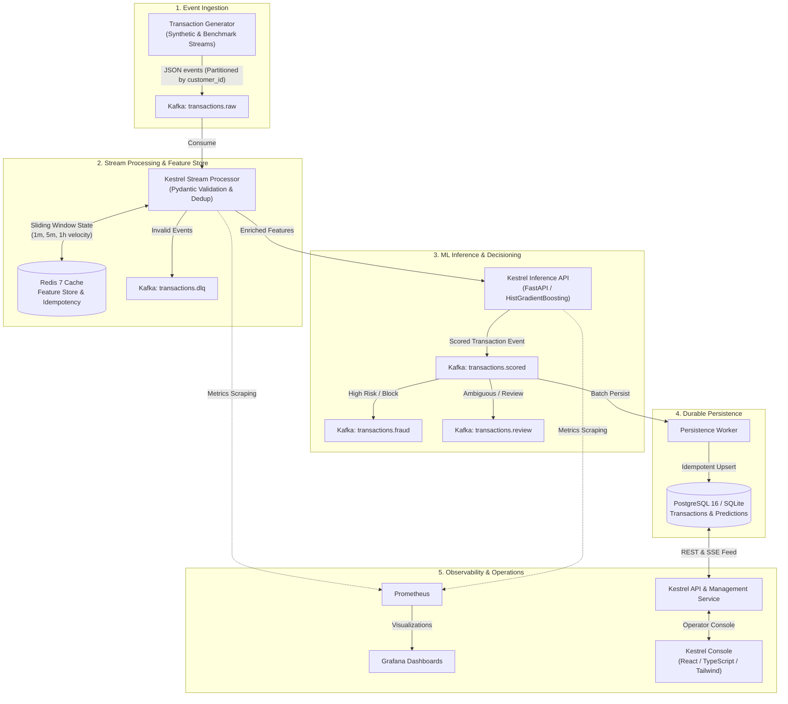

# Kestrel: Real-Time Fraud Detection & Streaming Intelligence Platform

[](https://www.python.org/downloads/)
[](https://nodejs.org/)
[](https://fastapi.tiangolo.com)
[](https://kafka.apache.org/)
[](https://opensource.org/licenses/MIT)

> **Kestrel** is an enterprise-grade, event-driven real-time fraud detection and monitoring infrastructure platform. Engineered with modern fintech principles, Kestrel ingests high-frequency financial transaction streams, computes sliding-window velocity and behavioral features in real time using Redis state, executes sub-5ms machine learning inference under acute class imbalance, applies multi-tier decisioning (APPROVE, REVIEW, BLOCK), and provides complete operational observability via Prometheus, Grafana, and an enterprise React/TypeScript operator console.

---

## Architecture Overview



---

## Core Capabilities

- **Streaming Architecture:** Apache Kafka in KRaft mode with customer-partitioned ordering, consumer group autoscaling, and dead-letter queues (`transactions.dlq`).
- **Low-Latency Feature Engineering:** Sub-millisecond sliding window velocity counters (1m, 5m, 1h), spending deviation ratios, and merchant diversity metrics backed by atomic Redis Sorted Sets.
- **Production ML Inference:** Calibrated `HistGradientBoosting` classifier handling severe class imbalance (~0.1-0.5% fraud), evaluated on PR-AUC, ROC-AUC, and financial cost-curve trade-offs.
- **Multi-Tier Decision Policy:** Configurable risk thresholds (`APPROVE < 0.30`, `REVIEW 0.30-0.75`, `BLOCK >= 0.75`) with granular diagnostic reason codes.
- **Durable Relational Storage:** PostgreSQL/SQLite persistence with Alembic migrations, foreign-key relationships, and idempotent upserts.
- **Data & Concept Drift Monitoring:** Statistical drift tracking using Population Stability Index (PSI) and Kolmogorov-Smirnov (KS) tests against baseline distributions.
- **Enterprise Operator UI:** Dense, dark-themed React 19/TypeScript console featuring live transaction streaming, fraud investigation queues, model comparison cards, and system health status.
- **Dual-Mode Execution:** Full containerized Docker Compose stack or zero-docker standalone native development mode.

---

## Project Structure

```text
fraud-detec-monitor-platform/
├── docs/                      # Architectural specifications, ADRs & runbooks
│   ├── DOCUMENTING.md         # Engineering journal and milestone tracker
│   ├── ARCHITECTURE.md        # System architecture and latency budgets
│   ├── SYSTEM_DESIGN.md       # Streaming reliability, Redis state, failure modes
│   ├── EVENT_SCHEMA.md        # Canonical event schemas
│   ├── KAFKA_DESIGN.md        # Kafka topic configurations & partition strategies
│   ├── FEATURE_ENGINEERING.md # Velocity algorithms and mathematical formulations
│   ├── ML_MODEL.md            # ML training, imbalance handling & evaluation
│   ├── DATABASE_SCHEMA.md     # Relational ER diagrams and indexing
│   ├── API_SPECIFICATION.md   # REST API OpenAPI contracts
│   ├── MONITORING.md          # Prometheus metrics & statistical drift
│   ├── LOAD_TESTING.md        # Benchmarking scenarios & methodology
│   ├── SECURITY.md            # Zero-trust data isolation & tokenization
│   ├── TESTING_STRATEGY.md    # Multi-tier testing framework
│   ├── DEPLOYMENT.md          # Runbooks for Docker and native modes
│   ├── CHANGELOG.md           # Semantic version change history
│   └── decisions/             # Architecture Decision Records (ADR-001 to ADR-006)
├── packages/
│   └── common/                # Shared Pydantic models, config loaders & logging
├── services/
│   ├── api/                   # FastAPI Inference & Management Service
│   ├── stream-processor/      # Async Kafka stream consumer & feature enrichment
│   ├── transaction-generator/ # Continuous synthetic financial event generator
│   └── persistence-worker/    # Decoupled database persistence consumer
├── ml/                        # Model training, preprocessing, artifacts & drift
├── frontend/                  # React 19 + TypeScript + Vite + Tailwind Console
├── infrastructure/            # Docker, Kafka, Redis, Prometheus & Grafana configs
├── tests/                     # Unit, integration, E2E, and load test suites
├── docker-compose.yml         # Multi-service container orchestration
├── .env.example               # Environment variables template
└── README.md                  # This file
```

---

## Quickstart

### Mode 1: Docker Compose (All Services Containerized)

```bash
# Clone and enter directory
cd fraud-detec-monitor-platform

# Copy environment variables
cp .env.example .env

# Build and start services
docker compose up --build -d

# Verify containers are running
docker compose ps
```

- **Kestrel Console (UI):** [http://localhost:5173](http://localhost:5173)
- **FastAPI Docs (Swagger):** [http://localhost:8000/docs](http://localhost:8000/docs)
- **Prometheus UI:** [http://localhost:9090](http://localhost:9090)
- **Grafana Dashboards:** [http://localhost:3000](http://localhost:3000) (`admin` / `admin`)

---

### Mode 2: Standalone Local Development (No Docker Required)

```powershell
# Activate Python virtual environment
.\.venv\Scripts\Activate.ps1

# Install common package and API requirements
pip install -e packages/common
pip install -r services/api/requirements.txt

# Start FastAPI Inference & Management Service
python -m uvicorn services.api.app.main:app --host 127.0.0.1 --port 8000 --reload

# In a second terminal: Start Frontend
cd frontend
npm install
npm run dev

# In a third terminal: Start Transaction Generator
python services/transaction-generator/app/main.py --mode stream --tps 10 --standalone
```

---

## Testing & Quality Assurance

```bash
# Run unit and schema tests
pytest tests/unit/ -v

# Run end-to-end integration test
pytest tests/e2e/ -v

# Run load test benchmark
python tests/load/load_test.py --tps 200 --duration 30
```

---

## Documentation Links

- [Engineering Journal & Milestones](file:///docs/DOCUMENTING.md)
- [System Architecture](file:///docs/ARCHITECTURE.md)
- [Event Schema Specification](file:///docs/EVENT_SCHEMA.md)
- [Feature Engineering & Redis Velocity](file:///docs/FEATURE_ENGINEERING.md)
- [Machine Learning Engine](file:///docs/ML_MODEL.md)
- [API Specification](file:///docs/API_SPECIFICATION.md)
- [Monitoring & Drift Detection](file:///docs/MONITORING.md)
- [Architecture Decision Records](file:///docs/decisions/)
