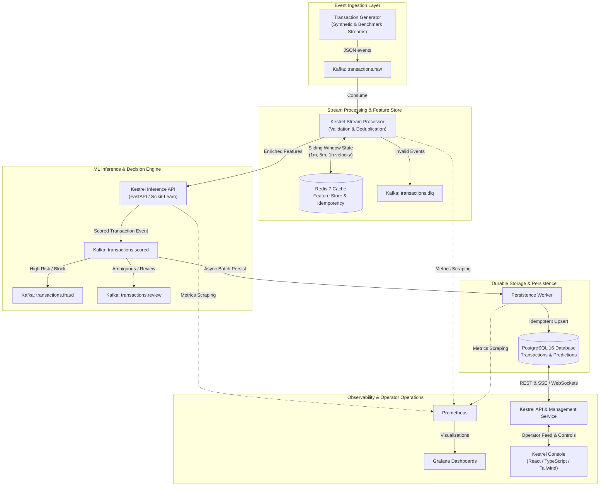

# Kestrel System Architecture

## 1. High-Level Architectural Overview

Kestrel is an event-driven, real-time fraud detection and monitoring platform designed for fintech transaction streams. The platform combines high-throughput event ingestion, atomic sliding-window feature enrichment, low-latency machine learning inference, decoupled persistence, and comprehensive operational observability.

---

## 2. Component Breakdown & Responsibilities

### 2.1 Transaction Generator (`services/transaction-generator`)
- Generates realistic, synthetically balanced financial transactions across multiple customer profiles, merchant categories, currencies, and payment channels.
- Injects identifiable normal behavioral trends and sophisticated fraud topologies (velocity spikes, geographic leaps, micro-charge carding testing, nocturnal outlier transactions).
- Supports continuous streaming at configurable transactions per second (TPS) or deterministic finite batches for reproducible evaluation.

### 2.2 Streaming Message Broker (`Apache Kafka KRaft`)
- Uses KRaft mode (no ZooKeeper dependency) for lightweight, high-performance local and containerized operation.
- Organizes events by entity-based partition key (`customer_id`), ensuring strict chronological ordering per customer.
- Segregates topics by lifecycle state:
  - `transactions.raw`: Raw ingested transactions.
  - `transactions.scored`: Transactions with computed features, fraud probabilities, and decisions.
  - `transactions.fraud`: Explicit block decisions dispatched for immediate alerting/action.
  - `transactions.review`: Ambiguous transactions flagged for manual fraud analyst review.
  - `transactions.dlq`: Malformed, unparseable, or poisoned messages rejected by the pipeline.

### 2.3 Stream Processor (`services/stream-processor`)
- Consumes from `transactions.raw` with at-least-once delivery semantics.
- Validates payload structure against Pydantic v2 schemas; routes invalid events directly to `transactions.dlq`.
- Performs real-time feature hydration using Redis 7:
  - Rolling transaction count in 1-minute, 5-minute, and 1-hour windows.
  - Rolling expenditure totals and average transaction amount.
  - Delta time since previous transaction for the customer.
  - Distinct merchant count in recent windows.
- Enforces deduplication using Redis idempotency keys with configurable TTLs.
- Dispatches feature vectors to the inference service and publishes enriched decision events to target Kafka topics.

### 2.4 ML Inference & API Service (`services/api`)
- Hosts the FastAPI application and loads trained, serialized machine learning models (HistGradientBoosting, Random Forest, Logistic Regression).
- Exposes high-speed scoring endpoint (`POST /api/v1/predict`) achieving sub-10ms inference latency.
- Applies a configurable multi-tier decision engine:
  - `APPROVE`: Probability < 0.30
  - `REVIEW`: 0.30 <= Probability < 0.75
  - `BLOCK`: Probability >= 0.75
- Exposes model metadata, performance metrics, data drift calculations (Population Stability Index, KS tests), and analyst feedback submission APIs.

### 2.5 Persistence Worker (`services/persistence-worker`)
- Consumes scored events asynchronously from `transactions.scored`.
- Performs idempotent batch upserts into PostgreSQL (`ON CONFLICT (transaction_id) DO NOTHING`).
- Completely decouples database write latency from the real-time stream processing path.

### 2.6 Persistence Layer (`PostgreSQL 16`)
- Normalized relational schema managing `transactions`, `predictions`, `features`, `fraud_decisions`, `model_versions`, `drift_reports`, and `feedback_records`.
- Preserves complete audit trail of manual reviews and ground-truth labels for ongoing model evaluation.

### 2.7 Frontend Console (`frontend/`)
- Enterprise-grade dark mode operations dashboard built with React 19, TypeScript, Vite, Tailwind CSS, and Lucide icons.
- Live real-time transaction monitor, interactive fraud alert investigation workbench, model performance visualization (ROC/PR curves, confusion matrices), feature drift telemetry, and Kafka/Redis infrastructure health gauges.

---

## 3. End-to-End Latency Budget

To maintain real-time SLA (< 50ms total end-to-end processing time from raw ingestion to scored decision):

| Step | Operation | Target Latency | P99 Target |
| :--- | :--- | :--- | :--- |
| 1 | Kafka Raw Ingestion & Consumer Fetch | 2 - 5 ms | 12 ms |
| 2 | Pydantic Schema Validation | 0.2 - 0.5 ms | 1.0 ms |
| 3 | Redis Feature Hydration (Pipelined) | 1 - 3 ms | 8 ms |
| 4 | Feature Vector Assembly & Scaling | 0.5 - 1 ms | 2 ms |
| 5 | Model Inference (HistGradientBoosting) | 2 - 5 ms | 10 ms |
| 6 | Decision Policy & Reason Coding | 0.1 - 0.2 ms | 0.5 ms |
| 7 | Kafka Scored Event Publishing | 2 - 4 ms | 10 ms |
| **Total** | **End-to-End Critical Path** | **8 - 18 ms** | **< 45 ms** |
