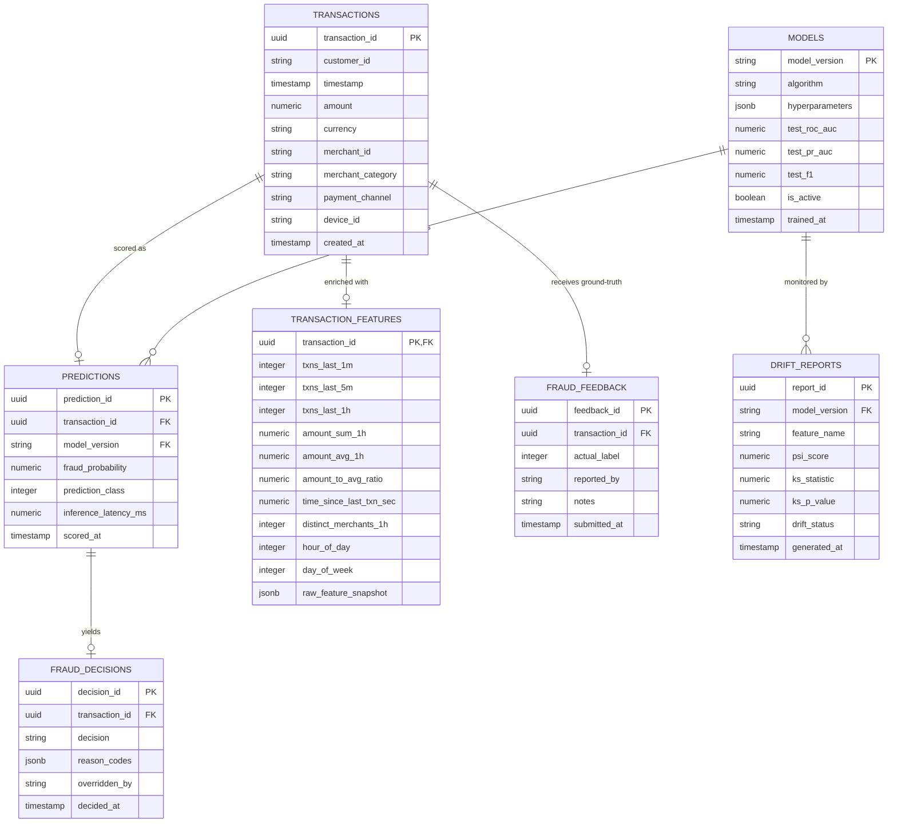

# Kestrel: Database Schema & Entity Relationships

## 1. Storage Architecture

Kestrel utilizes **PostgreSQL 16** (with SQLite dual-compatibility for lightweight standalone local execution). The schema is managed via SQLAlchemy 2.0 ORM models and Alembic database migrations.

---

## 2. Entity-Relationship (ER) Diagram

---

## 3. Indexing & Query Optimization Strategy

1. **Transaction ID Unique Lookup:**
   - `CREATE UNIQUE INDEX idx_transactions_txn_id ON transactions (transaction_id);`
   - Guarantees idempotent writes and $O(1)$ lookups.
2. **Customer Timeline Queries:**
   - `CREATE INDEX idx_transactions_customer_timestamp ON transactions (customer_id, timestamp DESC);`
   - Optimizes customer history queries and velocity audits.
3. **Decision & Risk Ingestion:**
   - `CREATE INDEX idx_fraud_decisions_decision ON fraud_decisions (decision, decided_at DESC);`
   - Accelerates analyst queries for the `REVIEW` and `BLOCK` worklists.
4. **Time-Series Partitioning Ready:**
   - The `transactions` and `predictions` tables use UTC `timestamp` fields prepared for monthly `pg_partman` range partitioning in production environments handling > 10M transactions/day.
