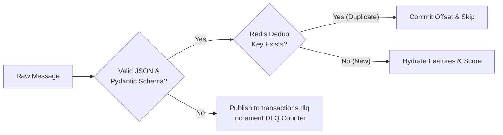

# Kestrel: Detailed System Design

## 1. Event Streaming & Reliability Strategy

### 1.1 Delivery Semantics & Idempotency
Real-time financial pipelines cannot tolerate silent loss or duplicated processing. Kestrel implements **at-least-once delivery** with **idempotent consumer processing** and **deduplicated persistence**:

1. **Producer Side:** Transaction generators and publishers produce with `acks=all` (or `acks=1` for high-volume benchmark testing), enabling idempotent producer options where supported (`enable.idempotence=true`).
2. **Stream Processor Deduplication:**
   - On message arrival, the stream processor evaluates a Redis key: `idempotency:txn:<transaction_id>`.
   - If the key exists, the message is recognized as a redelivery and skipped (or acknowledged immediately without re-scoring).
   - If absent, the key is set atomically with a 24-hour expiration (`SET idempotency:txn:<id> 1 EX 86400 NX`).
3. **Database Upsert Uniqueness:**
   - The PostgreSQL `transactions` and `predictions` tables enforce a `UNIQUE (transaction_id)` constraint.
   - Persistence writes utilize PostgreSQL `ON CONFLICT (transaction_id) DO NOTHING`.

### 1.2 Dead-Letter Queue (DLQ) Architecture
When an incoming message on `transactions.raw` fails Pydantic schema validation or cannot be decoded due to binary corruption:
1. Processing does not halt or crash the consumer loop.
2. The payload is encapsulated in a `DeadLetterEvent` envelope detailing:
   - Original unparsed payload (Base64 or string).
   - Error reason and stack trace.
   - Timestamp and consumer partition offset.
3. The event is published to `transactions.dlq`.
4. Consumer offset is safely committed to prevent pipeline starvation.
5. A Prometheus counter `fraud_dlq_messages_total` is incremented.

---

## 2. Real-Time Feature Store Architecture (Redis)

### 2.1 Sliding Window Velocity with Redis Sorted Sets
To track transaction counts and financial velocity across time windows without maintaining high-cardinality state in memory, Kestrel uses Redis Sorted Sets (`ZSET`):

- **Key Structure:** `velocity:cust:<customer_id>:txns`
- **Member:** `<transaction_id>:<amount>`
- **Score:** Unix timestamp in milliseconds (`event_time_epoch_ms`)

#### Atomic Window Query & Pruning Algorithm:
For every transaction at current timestamp `T`:
1. **Pipeline Execution:**
   - `ZREMRANGEBYSCORE key -inf (T - 3600000)`: Purge entries older than 1 hour.
   - `ZADD key T <txn_id>:<amount>`: Record current transaction.
   - `EXPIRE key 86400`: Refresh TTL to 24 hours.
   - `ZCOUNT key (T - 60000) T`: Count transactions in last 1 minute.
   - `ZCOUNT key (T - 300000) T`: Count transactions in last 5 minutes.
   - `ZCARD key`: Count transactions in last 1 hour.
   - `ZRANGEBYSCORE key (T - 3600000) T`: Retrieve recent records to calculate running sum and average amount.
2. **Fallback Behavior:**
   - If Redis connection times out or fails, the stream processor catches the exception, logs a warning, falls back to cold-start default features (velocity = 1, average = current amount), and raises an alert flag in the feature metadata so downstream models can account for missing context without failing the transaction.

---

## 3. Machine Learning Inference Architecture

### 3.1 Model Lifecycle Management
- Models are pre-trained and serialized as versioned artifacts in `ml/artifacts/` alongside their fitted preprocessor pipelines (`model.joblib`, `scaler.joblib`, `feature_names.json`, `metrics.json`).
- On FastAPI startup, the `ModelManager` singleton loads the active model artifact into memory, validates input schema compatibility, and warms up the inference path.
- Zero-downtime hot swapping of active model versions is supported via the admin API (`POST /api/v1/models/{model_id}/activate`), which atomically updates the in-memory inference reference.

### 3.2 Dual Serving Modes
1. **HTTP Microservice Mode:** The stream processor dispatches HTTP `POST /api/v1/predict` requests to the FastAPI inference service. This cleanly isolates inference scaling from streaming ingestion.
2. **In-Process Embedded Mode:** For ultra-low latency scenarios (< 3ms total inference), the stream processor can directly instantiate the `ModelManager` in-process, bypassing the HTTP network stack.

---

## 4. Failure Modes & Graceful Degradation Matrix

| Failure Mode | Detection | System Behavior | Recovery Mechanism |
| :--- | :--- | :--- | :--- |
| **Kafka Broker Down** | Connection exception / retry timeout | Producer & consumers enter exponential backoff retry; buffer local events up to memory ceiling. | Reconnects automatically via Kafka client retry loop. |
| **Redis Offline** | Redis timeout / ConnectionError | Velocity features fallback to neutral defaults; flag `redis_degraded=True` in payload. | Background reconnection watchdog reconnects once Redis returns. |
| **FastAPI Inference Down** | HTTP 503 / ConnectError | Stream processor retries up to 3 times with 50ms backoff; if still down, routes event to `transactions.review` with reason `INFERENCE_SERVICE_UNAVAILABLE`. | Service self-heals or container restarts; queue continues without loss. |
| **PostgreSQL Down** | DB connection pool exhaustion | Persistence worker pauses offset commits, holding messages in Kafka; resumes without data loss once DB is restored. | Automatic SQLAlchemy connection recycling upon DB recovery. |
| **Malformed Payload** | Pydantic ValidationError | Message forwarded to `transactions.dlq` with validation error details; consumer commits offset. | Analyst inspects DLQ topic or triggers re-processing tool. |
